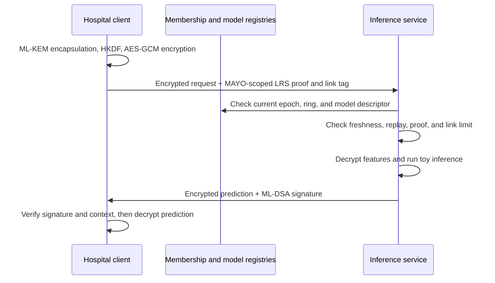

# Privacy-Preserving ML Inference for Healthcare

A research prototype for a hospital client to submit encrypted feature data
to an ML inference service, authenticate through a MAYO-based linkable
ring-signature construction designed to hide which member signed, and receive
an encrypted, authenticated prediction.

> **Research prototype only. Use synthetic data. Do not process real patient
> data or use this software for clinical decisions.** The LRS and complete
> system have not received formal security proofs or independent audit.

## What the project does

The prototype assembles a local request-to-response pipeline from separate
schema, cryptography, membership, model, and protocol components. A hospital
creates an encrypted request and generates a proof intended to show that some
member of the current membership ring authorized it without disclosing the
member. The service validates the request before opening its encrypted
features, runs a deterministic toy model, and returns an encrypted prediction
signed by the server.



The demo runs all components in one process with in-memory registries and
synthetic data. There is no network/API service, production membership
authority, persistent storage, or deployment configuration in this
repository. After request validation, the inference service decrypts and sees
the feature values. This is not homomorphic or multiparty encrypted inference.

## Request and response flow

1. The hospital client prepares a validated `SyntheticFeatures` value. It
   performs a fresh ML-KEM encapsulation to the service, derives an
   AES-256-GCM key with HKDF-SHA-256, and encrypts the canonical feature bytes.
2. The MAYO LRS adapter authenticates the request core, which binds request
   metadata, the encrypted payload, model descriptor, membership epoch, and
   response-correlation value. It returns a proof receipt and an epoch-scoped
   link tag.
3. The service validates request shape and size, current membership epoch,
   model registration, freshness, replay status, LRS proof, and anonymous
   rate limit before decapsulation and decryption.
4. The inference processor rechecks the model artifact hash, decrypts the
   features, and invokes the deterministic `toy-risk` model. Its score is only
   a workflow demonstration and has no clinical meaning.
5. The response builder encrypts the prediction with the request key and
   signs the response context with ML-DSA. The hospital checks the signature
   and pending request context, decrypts the result, and consumes its pending
   state.

Replay prevention and linkability rate limiting are separate: request IDs and
freshness protect against replays, while LRS tags allow repeated requests to
be associated within an epoch. The tag is intentionally linkable. Its raw
value is derived from the epoch and link secret, so epoch values must not be
reused; the current derivation also does not provide cross-scope tag
unlinkability. See the LRS explanation for details.

## MAYO-based LRS

MAYO is a signature primitive, not itself a ring signature. The project wraps
MAYO-3 in a project-specific RISC Zero proof relation: the prover proves that
one hidden membership row has both (a) a commitment opening to the secret used
for the link tag and (b) a MAYO public key that verifies the request
signature. The application exposes one LRS adapter, the native MAYO adapter;
it fails closed when its executable is unavailable.

The request format and guest journal do not expose the selected ring index,
MAYO signature, or link secret as public fields. Those values are prover
inputs to the proof, so their privacy depends on the proof system's witness
hiding behavior. That does not establish anonymity by itself. Proof soundness,
side-channel behavior, and the complete construction have not received
independent cryptographic review. The implementation uses the Rust `pq-mayo`
crate at 0.6.0 and RISC Zero 3.0.6, not the official MAYO-C implementation.
Official MAYO KAT comparison and a formal security analysis remain outstanding.

See [MAYO_LRS_IMPLEMENTATION_EXPLAINED.md](MAYO_LRS_IMPLEMENTATION_EXPLAINED.md)
for the construction equations, proof relation, encodings, and assumptions.
The earlier [implementation guide](MAYO_Scoped_ZK_LRS_Complete_Implementation_Guide.md)
and [design proposal](MAYO_LRS_DESIGN_PROPOSAL.md) provide additional
research context; the implementation explanation describes the code as it
currently exists.

## Implemented components

- **Schemas and serialization:** validated request/response models and
  deterministic JSON serialization.
- **Cryptography:** provider-backed ML-KEM and ML-DSA, HKDF-SHA-256,
  AES-256-GCM, and the MAYO LRS adapter.
- **Membership and models:** in-memory epoch snapshots and model descriptors
  tied to artifact SHA-256 hashes. These registries are process-local.
- **Protocol:** hospital request builder, ordered pre-decryption validator,
  replay store, linkability limiter, inference processor, and response
  builder/handler.
- **Demo:** a synthetic local round trip using a temporary model artifact.
- **Tests:** unit and integration coverage for schemas, adapters, registries,
  request validation, inference/response flow, and fail-closed native-backend
  behavior. Protocol flow tests use a test-only LRS stub at the test boundary;
  it is not available through runtime configuration or the adapter factory.

The implementation stages and original scope are in
[implementation_plan.md](implementation_plan.md). Security and privacy
assumptions are summarized in [SECURITY_NOTES.md](SECURITY_NOTES.md).

## Requirements and how they are fulfilled

The table maps the functional requirements in the implementation plan to the
current code. “Partial” means there is prototype behavior, but the operational
or security requirement is not complete.

| ID | Requirement | Implementation and status |
| --- | --- | --- |
| FR-01 | Server ML-KEM and ML-DSA keys | Provider-backed key generation is implemented. The demo creates ephemeral keys; secure persistence and managed key loading/rotation are not provided. **Partial.** |
| FR-02 | Hospital registration and membership epochs | The in-memory registry supports add, revoke, rotate, immutable snapshots, and latest-epoch policy. There is no production enrollment authority or persistent registry. **Partial.** |
| FR-03 | Model ID, version, and artifact hash | The model registry checks the artifact SHA-256 against its descriptor before registration and inference. **Implemented in prototype.** |
| FR-04 | Fresh ML-KEM encapsulation per request | The request builder encapsulates a new shared secret for every request. **Implemented.** |
| FR-05 | KDF-derived key with canonical context | HKDF-SHA-256 derives the request key from the KEM secret and request context. **Implemented.** |
| FR-06 | AES-256-GCM feature encryption | Features are canonically encoded and encrypted with request-specific AAD. **Implemented.** |
| FR-07 | MAYO-based anonymous LRS request authentication | The Python adapter, Rust host, and RISC Zero guest implement the MAYO-3 proof relation and linking tag. The executable is a separate build and has not been successfully built on this Windows host; the construction is also unaudited. **Source implemented; operational and security validation outstanding.** |
| FR-08 | Epoch, freshness, replay, and rate-limit checks | The validator enforces latest epoch and freshness; process-local stores enforce replay and LRS link limits. **Implemented for one process; shared deployment state outstanding.** |
| FR-09 | Reject invalid requests before decryption/inference | Ordered validation checks format, registry context, freshness, replay, proof, and limits before KEM decapsulation. Negative-path tests cover this ordering. **Implemented in prototype.** |
| FR-10 | Validate decrypted features | The feature parser checks the expected schema, types, finite values, and ranges before inference. **Implemented.** |
| FR-11 | Encrypt prediction with request key | The response uses the pending request key, a fresh nonce, and response-specific AAD. **Implemented.** |
| FR-12 | ML-DSA response authentication | The server signs the response's canonical critical fields; the client verifies the signature. **Implemented.** |
| FR-13 | Verify response association | A request-bound correlation token is checked against local pending state and authenticated by the server signature. This is not a separate zero-knowledge response-association proof. **Partial.** |
| FR-14 | Add, revoke, and rotate membership through epochs | Registry operations publish a new immutable epoch. **Implemented in the in-memory prototype.** |
| FR-15 | Privacy-safe structured audit logs | The project has no structured audit logging subsystem. **Not implemented.** |
| FR-16 | Make dependencies and experimental cryptography explicit | Dependencies are pinned in project manifests, and the README, LRS guide, and startup output identify the research backend and limitations. **Implemented for the current prototype.** |

The main non-functional requirements are handled as follows:

- **Cryptography and serialization:** Standard primitives use the
  `cryptography` provider, `sha3`, `pq-mayo`, and RISC Zero libraries; versions
  are recorded in `pyproject.toml` and the Rust manifests/lockfile. Schemas,
  canonical JSON, and a fixed-order binary LRS request core bind protocol
  fields. The MAYO and proof-system combination still needs independent
  validation.
- **Bounds and failures:** Request/response size limits and native subprocess
  timeouts are enforced. The application fails closed if its native LRS
  executable is missing or verification fails. In-memory replay claims and
  link-limit updates are synchronized within one process; a multi-worker
  deployment needs shared atomic storage.
- **Secrets and privacy:** The demo generates ephemeral keys and the code does
  not configure key-file permissions or persistent secret storage. Logs and
  telemetry are not a complete operational subsystem. Use synthetic inputs;
  after decryption the inference service sees the submitted feature values.
- **Testing and execution:** `pytest` covers unit and protocol flow behavior;
  test-only LRS stubbing exercises application integration without selecting a
  second runtime adapter. A full native proof-backed demo requires building
  the RISC Zero executable and remains unverified on this host.

## Current status and limits

The Python integration and protocol flow are implemented. The native Rust
source is present under `native/msz_lrs`, but the native executable must be
built separately before the demo can complete. This Windows host has not been
validated for the RISC Zero native toolchain. When the executable is absent,
the application fails closed rather than selecting another LRS implementation.

The default membership and model stores, replay state, rate-limit history,
and pending hospital request keys are in memory and lost when the process
ends. The client submits de-identified feature fields, but de-identification
does not guarantee anonymity. The service sees feature values after
successful decryption. Network anonymity, traffic-analysis resistance,
persistent operational storage, clinical validation, and encrypted inference
are outside the implemented scope.

No component should be described as uncrackable, formally anonymous,
production-ready, or fully post-quantum-secure. Use only synthetic examples.

## Development

Python 3.11 or newer is required. Install the package and developer tools in a
virtual environment:

```powershell
python -m venv .venv
.venv\Scripts\Activate.ps1
python -m pip install -e ".[dev]"
```

Run the test suite and lint checks:

```powershell
python -m pytest
python -m ruff check .
```

The native LRS requires Rust/Cargo and the RISC Zero guest toolchain. Build it
on a supported host/toolchain with:

```sh
cargo build --release --manifest-path native/msz_lrs/Cargo.toml
```

Then run the local synthetic demo:

```powershell
python -m ppml_healthcare.app demo
```

The demo requires the built release executable at
`native/msz_lrs/target/release/ppml-msz-lrs` (or the `.exe` name on Windows),
or a path set in `PPML_MSZ_LRS_EXECUTABLE`. It exits without running the
pipeline if the native backend cannot be found.

Configuration examples are in `.env.example`. The current package does not
load secret keys from configuration. Never commit or log cryptographic secret
keys.
